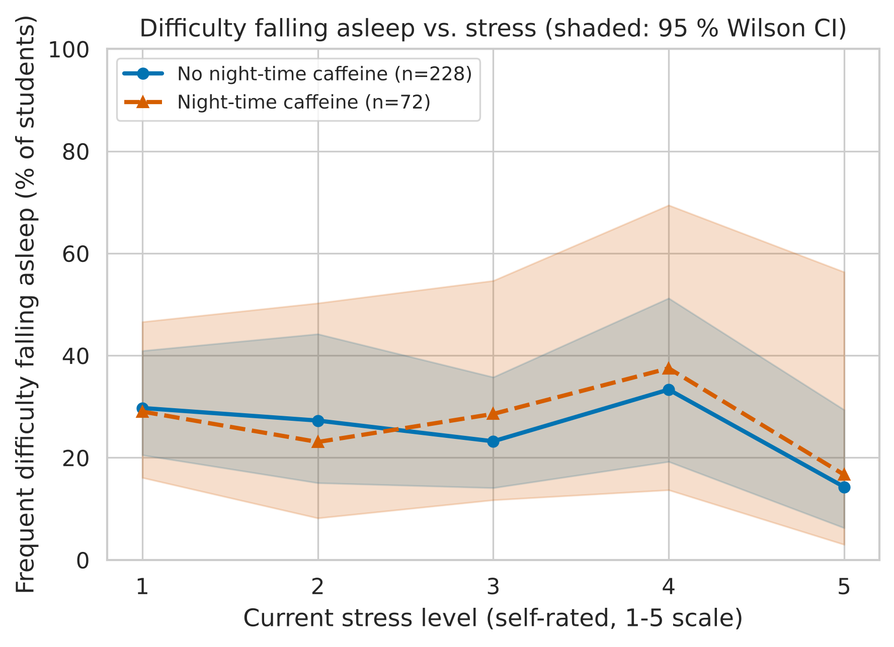
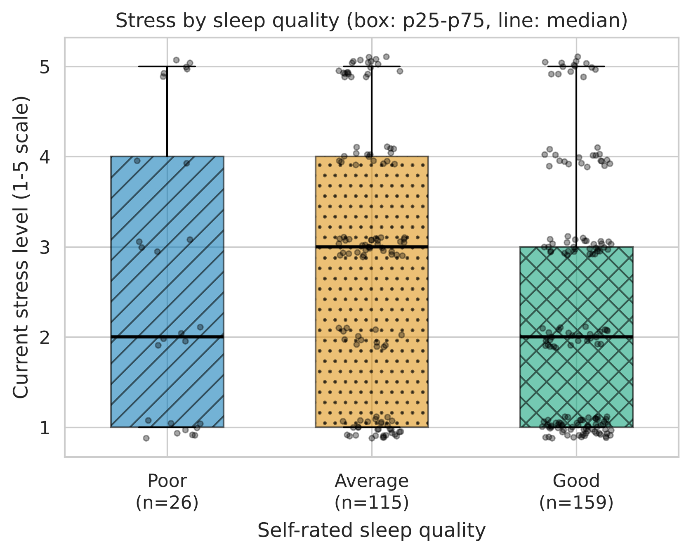
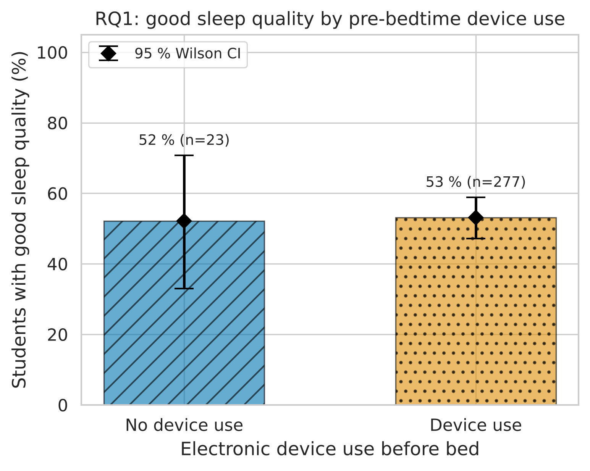
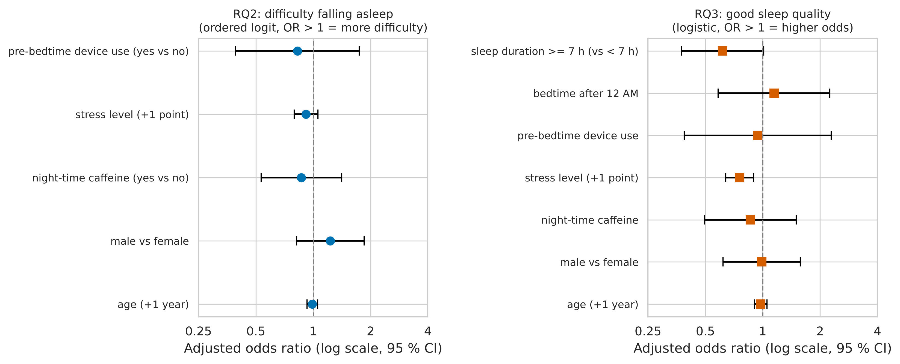

# Pre-bedtime Device Use, Stress and Sleep Quality Among University Students: A Secondary Analysis of an Open Cross-Sectional Dataset


**Authors:** Karabai Eldos, Serikova Zhanel (4th-year students, Narxoz University)  
**Course:** Research Methods · **Instructor:** Aisultan Shoiynbek · Almaty, 2026

> **Data provenance.** We did not collect the data. This is a *secondary analysis* of the open dataset
> Nawaz, S. (2026), *Academic Stress, Sleep Quality, and Lifestyle Factors Among University Students*, Mendeley Data, V1,
> DOI [10.17632/srd3wmjd4r.1](https://doi.org/10.17632/srd3wmjd4r.1), licensed **CC BY 4.0** (details: `data/raw/DATA_SOURCE.md`).

## Overview & Research Questions

**Aim:** assess whether pre-bedtime electronic-device use, stress and sleep-hygiene factors are associated with
self-rated sleep quality and difficulty falling asleep among university students (N = 300).

**Deviation from the Task 1 proposal.** The proposal planned a new survey with the PSQI, daily screen-time hours and a
digital-disconnection window. The open dataset contains **none** of these variables, so the research questions were
adapted to the closest available measures: PSQI → self-rated sleep quality (Poor / Average / Good); sleep-onset latency →
frequency of difficulty falling asleep; "active pre-bedtime use" → yes/no device use before bed. The topic, design
(quantitative, cross-sectional) and statistical approach are preserved.

| RQ | Question (adapted) | Expected direction (H1) |
|:--|:--|:--|
| RQ1 | Is device use before bed associated with sleep quality? | users have lower odds of good sleep |
| RQ2 | Do device use, stress and night-time caffeine predict difficulty falling asleep (ordered logit)? | OR > 1 |
| RQ3 | Which factors are associated with good sleep quality (logistic regression)? | ≥ 7 h sleep ↑; late bedtime, device use, stress, caffeine ↓ |

## Repository Structure

```
.
├── data/
│   ├── raw/Data_cleaned.csv          # original open dataset (unmodified), CC BY 4.0
│   ├── raw/test_run.jsonl            # lossless JSONL conversion (src/convert_raw.py)
│   ├── raw/DATA_SOURCE.md            # citation, licence, notes
│   └── processed/                    # metrics_summary.csv, tests_summary.csv
├── docs/domain_model.md              # LaTeX formalisation: variables, metrics, models, loss functions
├── notebooks/01_data_analysis.ipynb  # executed, reproducible analysis
├── reports/figures/                  # fig1-fig4 as .pdf (vector) and .png (300 DPI)
├── src/convert_raw.py  process_data.py  visualize.py
├── Makefile  requirements.txt  LICENSE  .gitignore
```

## Reproduce

```bash
pip install -r requirements.txt     # 1) environment (Python 3.11+)
make convert process figures        # 2) CSV -> JSONL, summary tables, figures
make notebook                       # 3) re-execute the notebook (Restart & Run All)
```

All random procedures are seeded (`SEED = 42`); outputs are reproducible for identical inputs and library versions.

## Results & Discussion

### Data validation
Validation (label harmonisation, duplicates, unknown labels, out-of-range values) is the analogue of warm-up filtering.
Guardrail metric — exclusion rate: **0.0%**; analysed sample **N = 300**.
The depositor had already cleaned the file, so no records needed to be removed.

| Validation step | Records affected |
|:---|---:|
| recoded label cells (whitespace / Yes-No case) | 0 |
| duplicate respondents | 0 |
| unknown category label | 0 |
| numeric value out of range | 0 |

### Descriptive statistics by self-rated sleep quality
Values: mean ± SD and median (p25–p75) with 2000-resample bootstrap 95 % CI of the median. Ordinal 1–5 ratings are
summarised numerically for comparability only.

| Variable | Sleep quality | n | Mean ± SD | Median (p25–p75) [95% CI] | p95 | p99 |
|:---|:---|---:|---:|:---|---:|---:|
| Stress level (1–5) | ALL | 300 | 2.55 ± 1.42 | 2.00 (1.00–4.00) [2.00, 3.00] | 5.00 | 5.00 |
| Stress level (1–5) | Poor | 26 | 2.65 ± 1.60 | 2.00 (1.00–4.00) [1.00, 3.50] | 5.00 | 5.00 |
| Stress level (1–5) | Average | 115 | 2.86 ± 1.44 | 3.00 (1.00–4.00) [3.00, 3.00] | 5.00 | 5.00 |
| Stress level (1–5) | Good | 159 | 2.30 ± 1.34 | 2.00 (1.00–3.00) [2.00, 2.00] | 5.00 | 5.00 |
| Anxiety level (1–5) | ALL | 300 | 2.53 ± 1.39 | 2.00 (1.00–4.00) [2.00, 3.00] | 5.00 | 5.00 |
| Anxiety level (1–5) | Poor | 26 | 2.96 ± 1.54 | 3.00 (1.25–4.00) [2.00, 4.00] | 5.00 | 5.00 |
| Anxiety level (1–5) | Average | 115 | 2.68 ± 1.43 | 3.00 (1.00–4.00) [2.00, 3.00] | 5.00 | 5.00 |
| Anxiety level (1–5) | Good | 159 | 2.36 ± 1.32 | 2.00 (1.00–3.00) [2.00, 3.00] | 5.00 | 5.00 |
| Depression level (1–5) | ALL | 300 | 2.34 ± 1.37 | 2.00 (1.00–3.00) [2.00, 2.00] | 5.00 | 5.00 |
| Depression level (1–5) | Poor | 26 | 2.35 ± 1.35 | 2.00 (1.00–3.00) [1.00, 3.00] | 4.75 | 5.00 |
| Depression level (1–5) | Average | 115 | 2.30 ± 1.36 | 2.00 (1.00–3.00) [2.00, 2.00] | 5.00 | 5.00 |
| Depression level (1–5) | Good | 159 | 2.37 ± 1.39 | 2.00 (1.00–3.00) [2.00, 2.00] | 5.00 | 5.00 |
| CGPA (0–4) | ALL | 300 | 3.46 ± 0.29 | 3.49 (3.23–3.65) [3.43, 3.52] | 3.96 | 4.00 |
| CGPA (0–4) | Poor | 26 | 3.49 ± 0.30 | 3.45 (3.24–3.72) [3.34, 3.67] | 3.98 | 4.00 |
| CGPA (0–4) | Average | 115 | 3.48 ± 0.29 | 3.49 (3.24–3.67) [3.43, 3.61] | 3.94 | 4.00 |
| CGPA (0–4) | Good | 159 | 3.45 ± 0.28 | 3.47 (3.22–3.63) [3.41, 3.52] | 3.96 | 4.00 |
| Difficulty falling asleep (0–4) | ALL | 300 | 1.82 ± 1.30 | 2.00 (1.00–3.00) [2.00, 2.00] | 4.00 | 4.00 |
| Difficulty falling asleep (0–4) | Poor | 26 | 1.73 ± 1.37 | 2.00 (1.00–2.75) [1.00, 2.00] | 4.00 | 4.00 |
| Difficulty falling asleep (0–4) | Average | 115 | 1.70 ± 1.28 | 2.00 (1.00–2.00) [1.00, 2.00] | 4.00 | 4.00 |
| Difficulty falling asleep (0–4) | Good | 159 | 1.92 ± 1.31 | 2.00 (1.00–3.00) [2.00, 2.00] | 4.00 | 4.00 |

### Hypothesis tests

| RQ | Test / estimate | Estimate | 95% CI | p | H1 supported |
|:---|:---|---:|:---|---:|:---:|
| RQ1 | Risk difference, good sleep: device users - non-users | 0.01 | [-0.20, 0.23] | 1.000 | no |
| RQ1 | Odds ratio of good sleep, users vs non-users (Fisher exact) | 1.04 | [0.44, 2.43] | 1.000 | no |
| RQ1 | Rank-biserial r, sleep-quality rank, users vs non-users (Mann-Whitney) | 0.01 | [-0.21, 0.25] | 0.942 | no |
| RQ2 | Ordered-logit OR, difficulty falling asleep: pre-bedtime device use (yes vs no) | 0.83 | [0.39, 1.75] | 0.616 | no |
| RQ2 | Ordered-logit OR, difficulty falling asleep: stress level (+1 point) | 0.92 | [0.79, 1.06] | 0.239 | no |
| RQ2 | Ordered-logit OR, difficulty falling asleep: night-time caffeine (yes vs no) | 0.87 | [0.53, 1.41] | 0.566 | no |
| RQ2 | Ordered-logit OR, difficulty falling asleep: male vs female | 1.23 | [0.82, 1.85] | 0.318 | – |
| RQ2 | Ordered-logit OR, difficulty falling asleep: age (+1 year) | 0.99 | [0.93, 1.06] | 0.748 | – |
| RQ2 | Spearman rho: stress level vs difficulty falling asleep | -0.07 | [-0.18, 0.04] | 0.255 | no |
| RQ3 | Logistic OR, good sleep quality: sleep duration >= 7 h (vs < 7 h) | 0.62 | [0.37, 1.01] | 0.055 | no |
| RQ3 | Logistic OR, good sleep quality: bedtime after 12 AM | 1.15 | [0.58, 2.25] | 0.693 | no |
| RQ3 | Logistic OR, good sleep quality: pre-bedtime device use | 0.94 | [0.39, 2.29] | 0.895 | no |
| RQ3 | Logistic OR, good sleep quality: stress level (+1 point) | 0.76 | [0.64, 0.90] | 0.001 | yes |
| RQ3 | Logistic OR, good sleep quality: night-time caffeine | 0.86 | [0.49, 1.50] | 0.595 | no |
| RQ3 | Logistic OR, good sleep quality: male vs female | 0.99 | [0.62, 1.58] | 0.961 | – |
| RQ3 | Logistic OR, good sleep quality: age (+1 year) | 0.98 | [0.90, 1.05] | 0.523 | – |

Share of students with good sleep quality by pre-bedtime device use:

| Group | n | Good sleep quality [95% Wilson CI] |
|:---|---:|:---|
| No device use | 23 | 52% [33, 71] |
| Device use | 277 | 53% [47, 59] |

"H1 supported" = p < 0.05 **and** effect in the pre-specified direction ("–" = no directional hypothesis).

### Figures



*Figure 1. Share of students with frequent difficulty falling asleep (Often / Almost always) by stress level and night-time caffeine use; shaded: 95 % Wilson CI. (File name kept from the Task 3 template; the figure shows the sleep-latency proxy.) Vector: `fig1_latency_vs_load.pdf`.*



*Figure 2. Stress level by self-rated sleep quality (box: p25–p75, line: median, points: respondents). Vector: `fig2_distribution_boxplot.pdf`.*



*Figure 3. RQ1 — share with good sleep quality by pre-bedtime device use; error bars: 95 % Wilson CI. Vector: `fig3_device_use_vs_sleep_quality.pdf`.*



*Figure 4. RQ2 / RQ3 — adjusted odds ratios with 95 % CI (log scale). Vector: `fig4_odds_ratios_forest.pdf`.*

### Discussion
- **RQ1 / RQ2 (device use):** the share of good sleepers is essentially the same in users (53 %) and non-users (52 %), and device use is not associated with difficulty falling asleep. All 95 % CIs include the null value. **No evidence of an association was found** — but only 23 students report no device use, so the comparison has low power and cannot rule out a moderate effect.
- **Stress:** higher stress is associated with lower odds of good sleep quality (adjusted OR per stress point = 0.76, 95 % CI [0.64, 0.90]), the only effect in the pre-specified direction.
- **Unexpected finding:** sleeping ≥ 7 h showed a borderline association with *lower* odds of good self-rated quality (p = 0.055). With coarse categories and self-rated quality this is more likely an artefact than a real effect.
- Results are consistent with the literature on stress and sleep, but our data **do not replicate** the device-use effects reported in the cited studies — a point worth discussing rather than hiding.

### Limitations
Cross-sectional design (association ≠ causation); self-reported, coarse measures; no PSQI, screen-time hours or latency in minutes
(proxies used); strongly unbalanced exposure (~92 % use devices before bed); single-institution convenience sample;
exploratory analyses without multiplicity correction; secondary data, so the measurement protocol is not under our control.

## Domain Model

LaTeX definitions of all variables and codings, effect sizes, bootstrap/Wilson CIs, the ordered-logit and logistic models
with their loss functions, and a notation table: **[docs/domain_model.md](docs/domain_model.md)**.

## Citation

**Cite the dataset:** Nawaz, S. (2026). *Academic Stress, Sleep Quality, and Lifestyle Factors Among University Students: A Cross-Sectional Dataset* (V1) [Data set]. Mendeley Data. https://doi.org/10.17632/srd3wmjd4r.1

**Cite this repository:**
```bibtex
@misc{karabai_serikova_2026_sleep,
  title  = {Pre-bedtime Device Use, Stress and Sleep Quality Among University Students: A Secondary Analysis},
  author = {Karabai, Eldos and Serikova, Zhanel},
  year   = {2026},
  note   = {Research Methods, Narxoz University},
  url    = {https://github.com/kaelowz/task3-research-methods}
}
```

## License

Code: MIT — see [LICENSE](LICENSE). Data: CC BY 4.0 (Nawaz, 2026) — attribution required, see `data/raw/DATA_SOURCE.md`.
