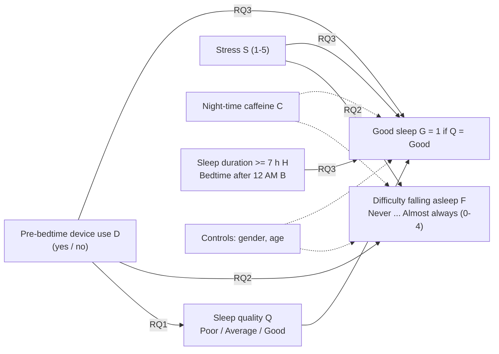

# Domain Model — Formal Definition of Variables, Metrics and Models

> **Track:** ML / Data Science → LaTeX formalisation of the target metrics, statistical models
> (loss functions) and a notation table. GitHub renders the `$...$` / `$$...$$` blocks.

## 1. Conceptual model

## 2. Notation

| Symbol | Meaning | Coding | Unit |
|---|---|---|---|
| $i = 1,\dots,n$ | respondent ($n = 300$) | – | – |
| $D_i$ | electronic device use before bed | 1 = yes, 0 = no | – |
| $Q_i$ | self-rated sleep quality | Poor = 0, Average = 1, Good = 2 | ordinal |
| $G_i$ | good-sleep indicator | $\mathbb 1\{Q_i=\text{Good}\}$ | – |
| $F_i$ | difficulty falling asleep (proxy of sleep-onset latency) | Never = 0, Rarely = 1, Sometimes = 2, Often = 3, Almost always = 4 | ordinal |
| $S_i$ | current stress level | 1–5 | points |
| $C_i$ | night-time caffeine | 1 = yes, 0 = no | – |
| $H_i$ | sleep duration ≥ 7 h | 1 = (7–8 h or > 8 h), 0 = (< 5 h or 5–6 h) | – |
| $B_i$ | regular bedtime after 12 AM | 1 = yes, 0 = no | – |
| $M_i$, $A_i$ | male indicator, age | 1 = male; years | – ; years |
| $\mathbf z_i$ | covariate vector | model specific | – |
| $\beta,\gamma,\tau_k$ | regression coefficients, ordinal thresholds | real | – |
| $B_{\text{boot}}$ | bootstrap resamples (= 2000) | integer | – |
| $\alpha$ | significance level (= 0.05) | real | – |

## 3. Metrics

**Share with good sleep in group $g$** and its Wilson 95 % CI ($\hat p = k/n_g$, $z = 1.96$):

$$\hat p_g = \frac{1}{n_g}\sum_{i\in g} G_i, \qquad
\mathrm{CI}_{\text{Wilson}} = \frac{\hat p + \frac{z^2}{2n_g} \pm z\sqrt{\frac{\hat p(1-\hat p)}{n_g} + \frac{z^2}{4n_g^2}}}{1+\frac{z^2}{n_g}}$$

**RQ1 effect sizes** (users $D=1$ vs. non-users $D=0$): risk difference and odds ratio

$$\mathrm{RD} = \hat p_{D=1} - \hat p_{D=0}, \qquad \mathrm{OR} = \frac{\hat p_{D=1}/(1-\hat p_{D=1})}{\hat p_{D=0}/(1-\hat p_{D=0})}$$

and the rank-biserial correlation from the Mann–Whitney statistic $U$ (positive = users have higher sleep-quality rank):

$$r_{rb} = \frac{2U}{n_{D=1}\,n_{D=0}} - 1$$

**Descriptive statistics** of a sample $x_1,\dots,x_m$: mean $\bar x$, SD $s=\sqrt{\tfrac{1}{m-1}\sum (x_j-\bar x)^2}$, median, percentiles $p_{25},p_{75},p_{95},p_{99}$ (linear interpolation).

**Bootstrap 95 % CI** (percentile method) for a statistic $\hat\theta$:

$$\mathrm{CI}_{95\%}(\hat\theta)=\Big[Q_{0.025}\big(\hat\theta^{*(1)},\dots,\hat\theta^{*(B_{\text{boot}})}\big),\ Q_{0.975}\big(\hat\theta^{*(1)},\dots,\hat\theta^{*(B_{\text{boot}})}\big)\Big]$$

**Spearman's rank correlation** $\rho_s$ is Pearson's $r$ computed on the ranks of $S_i$ and $F_i$.

**Guardrail metric — exclusion rate** (records removed by validation: duplicates, unknown labels, out-of-range values):

$$\rho_{\text{excl}} = \frac{n_{\text{raw}} - n_{\text{valid}}}{n_{\text{raw}}}$$

## 4. Statistical models and loss functions

**RQ2 — proportional-odds (ordered logit) model.** With thresholds $\tau_0<\tau_1<\tau_2<\tau_3$:

$$\Pr(F_i \le k \mid \mathbf x_i) = \sigma\!\big(\tau_k - \mathbf x_i^\top \boldsymbol\beta\big), \quad k=0,\dots,3,\qquad
\mathbf x_i^\top\boldsymbol\beta = \beta_D D_i + \beta_S S_i + \beta_C C_i + \beta_M M_i + \beta_A A_i$$

estimated by minimising the negative log-likelihood

$$\mathcal L_{\text{ord}}(\boldsymbol\beta,\boldsymbol\tau) = -\sum_{i=1}^{n}\log\Big[\sigma(\tau_{F_i}-\mathbf x_i^\top\boldsymbol\beta)-\sigma(\tau_{F_i-1}-\mathbf x_i^\top\boldsymbol\beta)\Big].$$

$\mathrm{OR}_j = e^{\beta_j}$ (a positive $\beta_j$ shifts probability toward **higher** categories, i.e. more frequent difficulty), so $\mathrm{OR}>1$ = more difficulty falling asleep, as stated in the figures.
$H_0:\beta_D = 0$ vs. $H_1:\beta_D > 0$ (device use ↑ difficulty); analogously for $S$ and $C$.

**RQ3 — logistic regression for good sleep quality:**

$$\operatorname{logit}\Pr(G_i=1)=\gamma_0+\gamma_H H_i+\gamma_B B_i+\gamma_D D_i+\gamma_S S_i+\gamma_C C_i+\gamma_M M_i+\gamma_A A_i$$

estimated by minimising the cross-entropy loss

$$\mathcal L_{\text{logit}}(\boldsymbol\gamma) = -\sum_{i=1}^{n}\Big[G_i\log\hat\pi_i+(1-G_i)\log(1-\hat\pi_i)\Big],\qquad \hat\pi_i=\sigma(\mathbf x_i^\top\boldsymbol\gamma),$$

reported as $\mathrm{OR}_j=e^{\gamma_j}$ with Wald 95 % CI. Pre-specified expected directions: $\gamma_H>0$; $\gamma_B,\gamma_D,\gamma_S,\gamma_C<0$.

## 5. Data schema (`data/raw/test_run.jsonl`, 31 variables per respondent)

Source: Nawaz (2026), Mendeley Data, DOI 10.17632/srd3wmjd4r.1, CC BY 4.0 (see `data/raw/DATA_SOURCE.md`). Variables used in the analysis:

| Field | Type | Role |
|---|---|---|
| `Use_of_electronic_devices_before_bed` | Yes / No | exposure $D$ |
| `Sleep_quality` | Poor / Average / Good | outcome $Q$, $G$ |
| `Difficulty_falling_asleep` | Never … Almost Always | outcome $F$ |
| `Average_sleep_duration_per_night` | <5 / 5-6 / 7-8 / >8 hrs | predictor $H$ |
| `Bedtime_on_regular_nights` | Before 10 PM … After 12 AM | predictor $B$ |
| `Current_stress_level` | 1–5 | covariate $S$ |
| `Night_time_caffeine_consumption` | Yes / No | covariate $C$ |
| `Gender`, `Age` | Female/Male, years | covariates |
| `Anxiety_level`, `Depression_level`, `Current_CGPA` | 1–5, 1–5, 0–4 | descriptives |
| `Q Number` | int | anonymous respondent id |

Not available in the dataset (hence the adapted RQs): PSQI score, screen time in hours, sleep-onset latency in minutes, disconnection window.
